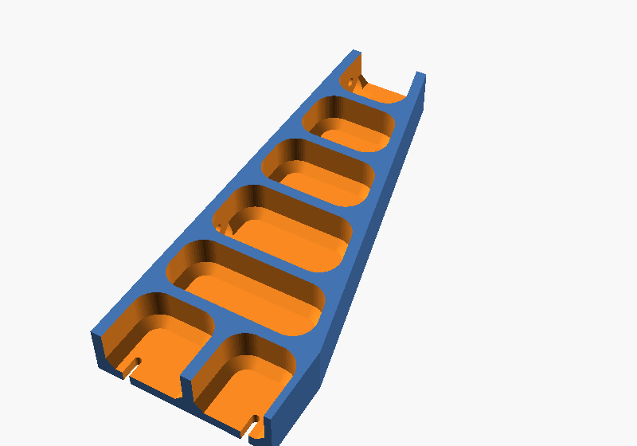

# prusa-mk3-frame-support

A printable version of the Prusa MK3(S+) frame support...in case you lose yours like I did.

This is a scad implementation of the sheet-metal frame support bracket that comes with the Prusa
MK3(S+) kit, if you're missing it. The printed part:



Photos of a printed one, on its own and installed, are to come (#2).

## Files

- `frame_support.scad` — parametric source; every dimension is a named variable at the top.
- `frame_support.stl` — ready to print.

To re-export after changing a parameter:

```sh
openscad -o frame_support.stl frame_support.scad
```

## Dimensions

The printed part keeps the sheet-metal bracket's footprint and mounting points, and
replaces the thin L-profile with a pocketed, ribbed block.

|                      |                                                                                             |
| -------------------- | ------------------------------------------------------------------------------------------- |
| Footprint            | 80 mm wide at the slotted end, tapering to 40 mm over 206 mm length (taper starts 35 mm in) |
| Height               | 22.2 mm (the original flange height)                                                        |
| Floor / walls / ribs | 5 mm                                                                                        |
| Slots                | 2 × 3.3 mm wide (M3), 54 mm apart, open at the wide end                                     |
| Side-wall holes      | 2 × Ø4.5 mm (M4), 117 mm apart, 11.2 mm up, with Ø16 mm head clearance on the inside        |
| Chamfers             | 4 mm × 45° where pocket floors meet the walls; 0.5 mm on the slot edges at the bed          |

## Printing

Print flat-face down, as modelled; no supports are needed.

## Checks

`just test` takes under a second on OpenSCAD 2026.10.15. It renders the part with warnings treated
as errors and checks that it's one solid of the size above; that each slot and side hole is open,
with a probe a little narrower than it passed through where it should be; and that
`frame_support.stl` is still the same part as the source renders, by size and volume. Different
OpenSCAD versions mesh it differently, so it doesn't compare triangles.

`just images` renders the picture above.

## Licence

MIT; see [LICENSE](LICENSE).

Prusa is a trademark of Prusa Research a.s. This project isn't affiliated with Prusa Research; the
part is made to fit their printer.
